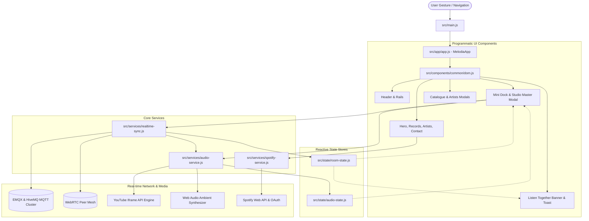

# Melodia Beat Records — System Architecture

## 1. Primary Objective & Architectural Philosophy

Melodia Beat Records is an ultra-high performance, luxury glassmorphic audio web and mobile application designed for audiophile studio discographies and real-time synchronized group listening sessions ("Listen Together").

### Architectural Core Principles:
1. **Strictly Programmatic UI**: The website interface contains **zero authored HTML and zero JSX/TSX**. All DOM elements, SVGs, modals, controls, and event listeners are constructed programmatically in JavaScript using native DOM creation APIs (`document.createElement`, `document.createElementNS`, `element.append()`, `element.replaceChildren()`).
2. **Minimal HTML Bootstrap Exception**: As mandated by Vite's build lifecycle, a minimal HTML entry file (`index.html`) is retained strictly as a bootstrap container (`<div id="app"></div>`) with Google Fonts and meta tags. All actual application UI is mounted dynamically into `#app` by `src/main.js`.
3. **Structured CSS Separation**: All layout, glassmorphism, responsive breakpoints, and animations reside in dedicated `.css` sheets within `src/styles/`. JavaScript handles DOM structure, logic, state, and event streams without inline styling anti-patterns.
4. **Server-Authoritative Realtime Sync**: A globally synchronized multi-user audio room experience powered by an enterprise dual-broker MQTT cluster with secondary WebRTC mesh channels, monotonic version numbering, and continuous sub-2-second drift reconciliation.

---

## 2. High-Level Architecture Diagram



---

## 3. Directory Layout & Separation of Responsibilities

```text
melodia/
├── index.html                   # Minimal Vite bootstrap container (<div id="app"></div>)
├── package.json                 # Project dependencies & build scripts
├── vite.config.js               # Vite bundler configuration
├── vercel.json                  # Single-Page Application rewrites & security headers
├── .env.example                 # Safe environment variable placeholders
│
├── docs/                        # Complete technical documentation
│   ├── ARCHITECTURE.md          # Architecture, state flows, and diagrams
│   ├── PROJECT-MAP.md           # File-by-file responsibilities and dependencies
│   └── INTEGRATIONS.md          # Protocol specifications and external service boundaries
│
└── src/
    ├── main.js                  # Application entry point; boots app on DOM ready
    ├── data.js                  # Studio discography, tracklists, artists, and playlists
    │
    ├── app/
    │   ├── app.js               # Central application coordinator; mounts UI into #app
    │   └── router.js            # Viewport scroll observer & URL room routing (/room/:id)
    │
    ├── components/
    │   ├── common/
    │   │   ├── dom.js           # Safe programmatic DOM & SVG builders (zero innerHTML)
    │   │   ├── banner.js        # Listen Together invitation banner
    │   │   └── toast.js         # Non-intrusive toast notifications
    │   │
    │   ├── layout/
    │   │   ├── header.js        # Top glassmorphic header, navigation, install button
    │   │   ├── rails.js         # Vertical slide tracker (01/04) & social profiles rail
    │   │   └── mobile-nav.js    # Responsive bottom navigation bar
    │   │
    │   ├── sections/
    │   │   ├── hero-section.js     # Hero landing with semantic <h1> and CTAs
    │   │   ├── records-section.js  # 3D album cover showcase & Spotify spotlight
    │   │   ├── artists-section.js  # 3D resident artist cards & bio summaries
    │   │   └── contact-section.js  # Studio booking contact form & address info
    │   │
    │   ├── player/
    │   │   ├── mini-dock.js     # Floating mini player dock with volume slider
    │   │   └── master-modal.js  # Studio Master Player modal with room controls
    │   │
    │   └── modals/
    │       ├── catalogue-modal.js  # Discography catalogue card grid modal
    │       └── artists-modal.js    # Studio artists roster card grid modal
    │
    ├── services/
    │   ├── audio-service.js     # Unified YouTube streaming player + Web Audio synth
    │   ├── realtime-sync.js     # Enterprise MQTT + WebRTC room synchronization
    │   └── spotify-service.js   # Spotify OAuth implicit grant & playlist metadata
    │
    ├── state/
    │   ├── audio-state.js       # Observable reactive playback state manager
    │   └── room-state.js        # Observable reactive synchronized room state manager
    │
    ├── styles/
    │   ├── tokens.css           # Custom properties, colors, typography scales, radii
    │   ├── global.css           # Base resets, background canvas, noise overlay
    │   ├── layout.css           # Header, rails, snap container, mobile nav styles
    │   ├── sections.css         # Hero, records showcase, artists, contact styles
    │   ├── player.css           # Mini dock, master player modal, spinning vinyl
    │   ├── volume.css           # Individual device volume controls & range sliders
    │   ├── room.css             # Listen Together hub, invite banner, presence pills
    │   ├── modals.css           # Glassmorphic modal backdrops, catalogue grids
    │   └── main.css             # Master CSS entry point importing all modular sheets
    │
    └── utils/
        └── visualizer.js        # BackgroundAtmosphere bokeh canvas & SpectrumVisualizer
```

---

## 4. State Management Architecture

Compromising between local responsiveness and cloud synchronization requires clear state domain boundaries:

| State Domain | Owner Module | Consumers | Characteristics |
| :--- | :--- | :--- | :--- |
| **Audio Playback** | `AudioEngine` (`audio-service.js`) via `audioState` (`audio-state.js`) | Mini Dock, Master Modal, Spectrum Analyzer | Track title, artist, album cover, playback status (playing/paused), progress %, current time. |
| **Device Volume** | `AudioEngine` (`audio-service.js`) | Dock Volume Slider, Modal Volume Card | **Local to device**; saved to `localStorage('mel_volume')`. Adjusting volume on one device never alters peers' volume. |
| **Room Sync** | `RealtimeRoomSync` (`realtime-sync.js`) via `roomState` (`room-state.js`) | Room Hub, Header status dot, Invite Banner | Room code (e.g. `MEL-8K9X`), connection status, listener presence count, shareable URL. |
| **Spotify OAuth** | `SpotifyService` (`spotify-service.js`) | Records Section Spotlight Bar | Access token, token expiry, current Spotify user display name. |
| **Viewport Navigation** | `AppRouter` (`router.js`) | Left Rail (01/04), Header nav links, Mobile nav | Active section identifier (`hero`, `records`, `artists`, `contact`). |

---

## 5. Realtime Room Synchronization Protocol

### 5.1 Communication Topology
- **Primary Transport**: WebSocket connection to clustered MQTT brokers (`wss://broker.emqx.io:8084/mqtt` and `wss://broker.hivemq.com:8884/mqtt`) with automatic failover.
- **Secondary Co-Transport**: WebRTC data channels via PeerJS mesh for sub-10ms peer notifications.
- **Heartbeat & Presence**: Peers emit retainable presence pings every 5 seconds on `melodia/v1/rooms/{roomId}/presence/{clientId}`. Dead peers (>18s without ping) are automatically pruned.

### 5.2 Conflict Resolution & Monotonic Ordering
Room mutations carry monotonic vector clocks:
```json
{
  "roomId": "MEL-8K9X",
  "roomName": "Melodia Studio Room",
  "track": {
    "title": "Toh Phir Aao",
    "artist": "Mustafa Zahid & Pritam",
    "ytId": "n_VrRuNkbrE",
    "durationSeconds": 348
  },
  "status": "PLAYING",
  "position": 42.5,
  "updatedAt": 1776311200000,
  "version": 4,
  "updatedBy": "user_k92j4_39fa"
}
```
Clients reject incoming packets if `remote.version < current.version` or if timestamps indicate a stale replay.

### 5.3 Continuous Drift Reconciliation
To account for clock skew and network buffering across disparate mobile and desktop platforms:
- Background ticker calculates elapsed expected position: `expected = position + (now - updatedAt) / 1000`.
- If `|expected - actual| > 1.8s`, the audio engine smoothly seeks the local player to reconcile in lockstep without interrupting audio playback.

---

## 6. Security Boundaries

1. **Zero XSS / Zero HTML Injection**: Because no `innerHTML` or template literal strings are inserted into the DOM, untrusted user inputs (e.g. room codes, email inputs) cannot execute malicious scripts.
2. **Safe URL Token Cleaning**: Spotify OAuth token fragments in `window.location.hash` are immediately consumed and stripped using `window.history.replaceState` to prevent token leakage in browser history.
3. **No Private Secrets in Client Code**: All environment variables use public client identifiers; private client secrets are guarded in serverless environments.
